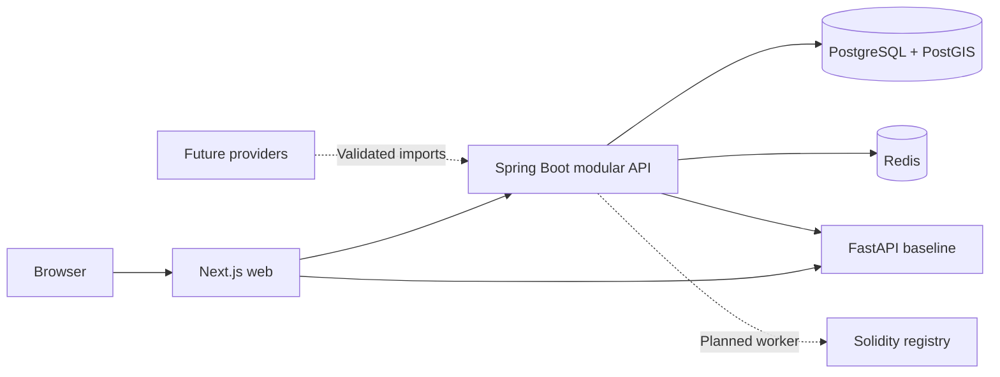
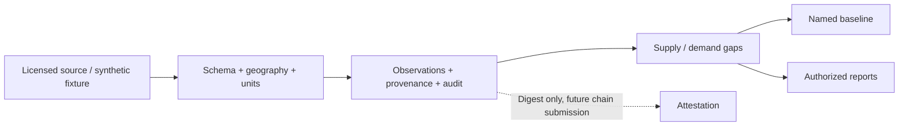
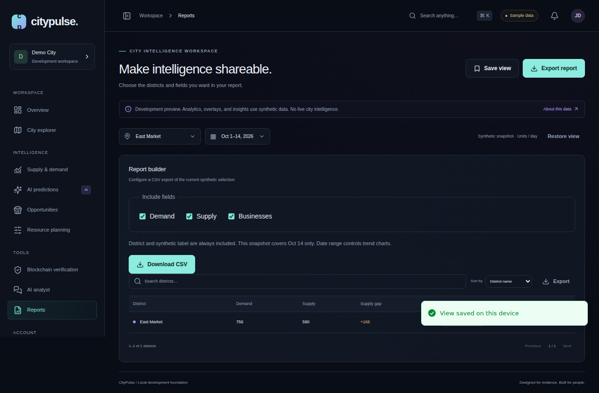

<p align="center"></p>

<p align="center">
  <a href="https://github.com/manikantbindass/CityPulse/actions/workflows/ci.yml"></a>
  <a href="https://github.com/manikantbindass/CityPulse/actions/workflows/security.yml"></a>
</p>

<p align="center"><strong>Understanding City Supply and Demand Business Analysis Using AI and Blockchain.</strong></p>

<p align="center">Geospatial context. Explainable baselines. Traceable evidence.</p>

> **Development foundation.** Workspace analytics, district overlays, KPI deltas and example insights are synthetic. Real Spring API and FastAPI endpoints run locally. No production deployment, real city partnership, forecast accuracy, public demo or on-chain submission is claimed.

[Static header](docs/assets/citypulse-header-static.svg) · [Product requirements](docs/PRD.md) · [Architecture](docs/architecture/README.md) · [API behavior](docs/api/backend.md) · [Blockchain guide](docs/blockchain.md) · [Model card](docs/model-card.md) · [Developer guide](docs/development.md) · [Ingestion demo](docs/ingestion.md) · [Data dictionary](docs/data-dictionary.md)

## Navigation

[Features](#features) · [Architecture](#architecture) · [Repository](#repository) · [Installation](#installation) · [Docker](#docker-quick-start) · [Screenshots](#screenshots) · [Testing](#testing) · [Roadmap](#roadmap) · [FAQ](#faq) · [Security](#security) · [Contributing](#contributing) · [License](#license)

## Features


| Capability        | Available now                                                                     | Planned next                                                         |
| ----------------- | --------------------------------------------------------------------------------- | -------------------------------------------------------------------- |
| Urban workspace   | Responsive sidebar, command palette, seed charts/maps, tables and saved views     | Real authorized aggregates and user sessions                         |
| Registry          | Tenant-scoped cities, zones, geographic areas and businesses                      | Full update/archive lifecycle and controlled boundary edits          |
| Supply and demand | Validated observations, inventories, history, gap calculations                    | Licensed feeds and completeness monitoring                           |
| AI                | Measured seasonal/moving-average/Ridge/XGBoost comparisons and Java orchestration | Backtesting, seasonality, calibrated uncertainty and recommendations |
| Resource planning | Proportional gap allocation, no dispatch                                          | Constraints, fairness review and approved workflows                  |
| Provenance        | Local hashes, digest receipts and submitter-scoped Solidity tests                 | Canonicalization, wallets and attestation workers                    |
| Governance        | OIDC resource server, membership/scopes, audit, rate limit, idempotency           | Web sessions, tenant onboarding and retention automation             |
| Reporting         | Filtered CSV and custom seed reports                                              | Async report jobs and expiring downloads                             |

### Technology


## Architecture





Domain logic stays separate from controllers and persistence. Modular simplicity comes first; outbox/Redpanda, Kubernetes and Terraform have explicit future boundaries. See [C4 diagrams and scaling path](docs/architecture/README.md), [ADRs](docs/architecture/decisions/README.md), and [canonical data policy](docs/data-policy.md).

## Repository

<details>
<summary>Explore the monorepo</summary>

```text
CityPulse/
├── apps/                 # web; admin extraction boundary
├── services/             # api, ai-engine; ingestion/reporting boundaries
├── packages/             # contracts, ui and shared-config boundaries
├── blockchain/           # contracts, scripts and test
├── data/                 # sample CSV/JSON/GeoJSON and schemas
├── infrastructure/       # docker; planned kubernetes/terraform; monitoring
├── docs/                 # PRD, architecture, API, assets, reports, presentations
├── tests/                # cross-service validation guidance
├── scripts/              # setup, integrity, smoke and export tools
├── assets/               # reserved source assets
├── tools/                # optional tool package boundary
├── .github/workflows/    # CI and security
└── compose.yaml
```

Reserved modules contain documentation rather than fabricated services. [Frontend details](docs/frontend.md) describe all routes and local-only behavior.

</details>

## Installation

Prerequisites: Git, Node 22.14+ or 24, npm 10+, Java 21+, Maven 3.9+, Python 3.11–3.14, Docker Desktop in Linux-container mode with Compose v2. Initial downloads need internet. No paid cloud account or blockchain funds are required.

```sh
git clone https://github.com/manikantbindass/CityPulse.git
cd CityPulse
npm ci
python scripts/setup-env.py
npm run hooks:install
```

## Docker quick start

```sh
docker compose up --build -d --wait
python scripts/smoke.py
# View logs
docker compose logs -f
# Stop, retaining data
docker compose down
```

Open [local web](http://localhost:3000). API readiness: [localhost:8080](http://localhost:8080/actuator/health/readiness). AI health: [localhost:8000](http://localhost:8000/health). `.env` contains generated local secrets and is ignored. The local profile grants developer permissions and binds ports to loopback. Public hosting requires OIDC web sessions and authorization changes documented in [SECURITY.md](SECURITY.md).

For host commands, AI virtual environments, local chain startup, and troubleshooting, see [development](docs/development.md).

## Screenshots



[Mobile report screenshot](docs/assets/workspace-mobile.png) · [Measured synthetic model comparison](docs/assets/model-comparison.png)

These are real browser captures from the PR CI interaction flow. See [validation report](docs/validation.md) for actual captures and test results. The UI labels seeded data consistently. Screenshots do not represent live city intelligence.

## Testing

```sh
npm run lint
npm run typecheck
npm test --workspace apps/web
npm run build
npm run test:e2e --workspace apps/web
npm run test:contracts
mvn -f services/api/pom.xml verify
# With AI virtual environment active:
python -m pytest services/ai-engine/tests
ruff check services/ai-engine
python scripts/check_repository.py
npm run format:check
```

Tests cover scope/tenant boundaries, persistence constraints, idempotency, baseline validation, local contracts, component semantics and browser flows. Testcontainers requires Docker; skipped tests are not passing integration evidence. CI defines actual functional checks and badges report GitHub's state without invented coverage percentages.

## Roadmap

- [x] Monorepo, governance, visual README and architecture contracts
- [x] Locally runnable web/API/AI starters, canonical schema and fixtures
- [x] Workspace routes and tenant-scoped backend operations
- [ ] Public OIDC web sessions and automated tenant lifecycle
- [ ] Licensed provider connectors and source quality/coverage controls
- [ ] Backtested forecasting, calibrated intervals and model monitoring
- [ ] Real LLM analyst with evidence and tool authorization
- [ ] On-chain attestation integration and audited approval workflows
- [ ] Outbox/Redpanda when replay and consumers justify it
- [ ] Production hosting, Kubernetes/Terraform and operational SLO evidence

## FAQ

<details><summary>Are the sample numbers real?</summary>

No. Seeds, KPI changes, district overlays, example opportunities and interval bands are synthetic. The real API persists local data; source evidence must be validated before any real decision.

</details>

<details><summary>Does blockchain make the data true?</summary>

No. A digest can establish integrity relative to a reference and who submitted it. Trust, licensing, and data quality remain separate responsibilities.

</details>

<details><summary>Why no Kafka or Kubernetes yet?</summary>

The current modular application needs neither a production event broker nor a cluster. Add workers and measure bottlenecks first. Architecture decisions define an incremental migration path.

</details>

<details><summary>Can I sign in or use the AI analyst?</summary>

Authentication forms are UI previews, with no submitted/stored credentials. Java supports an external OIDC resource server. The analyst uses fixed local rules and discloses that it is not an LLM.

</details>

## Security

Read [SECURITY.md](SECURITY.md) before reporting a vulnerability. Never commit `.env`, tokens, private keys or personal city records. See [retention and provenance](docs/data-policy.md) for implemented constraints and remaining policy work.

## Contributing

Read [CONTRIBUTING.md](CONTRIBUTING.md), [Code of Conduct](CODE_OF_CONDUCT.md), and [changelog](CHANGELOG.md). Use a feature branch and Conventional Commits; preserve history and include reproducible validation.

## License

**License selection pending.** No LICENSE file is added because the owner has not explicitly selected a license. Do not assume an open-source grant. Third-party packages retain their own licenses.


