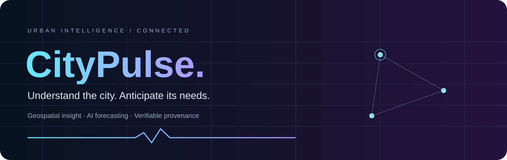
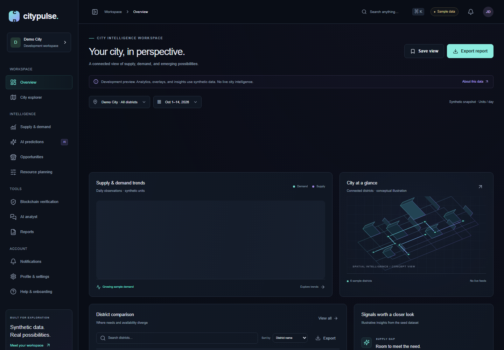
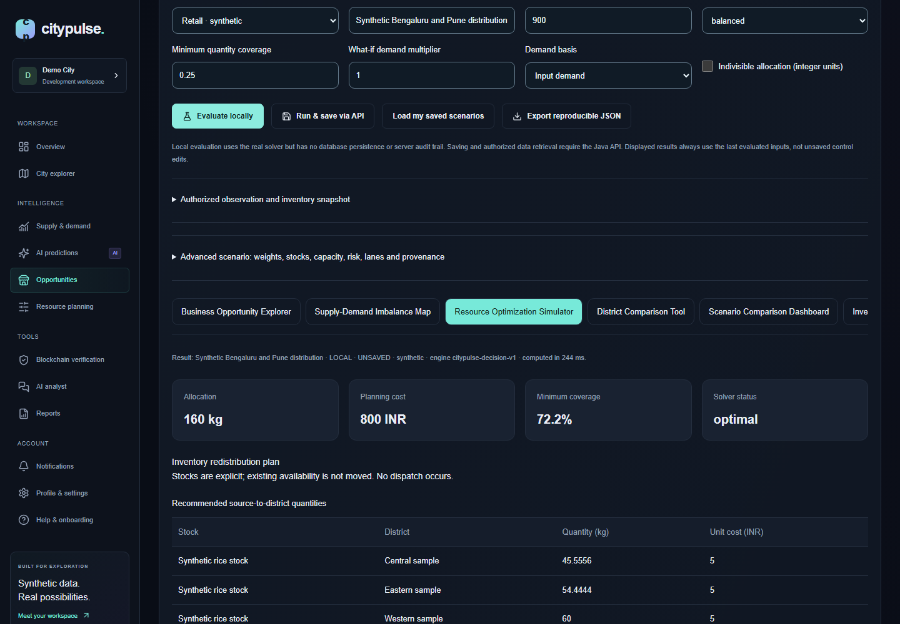
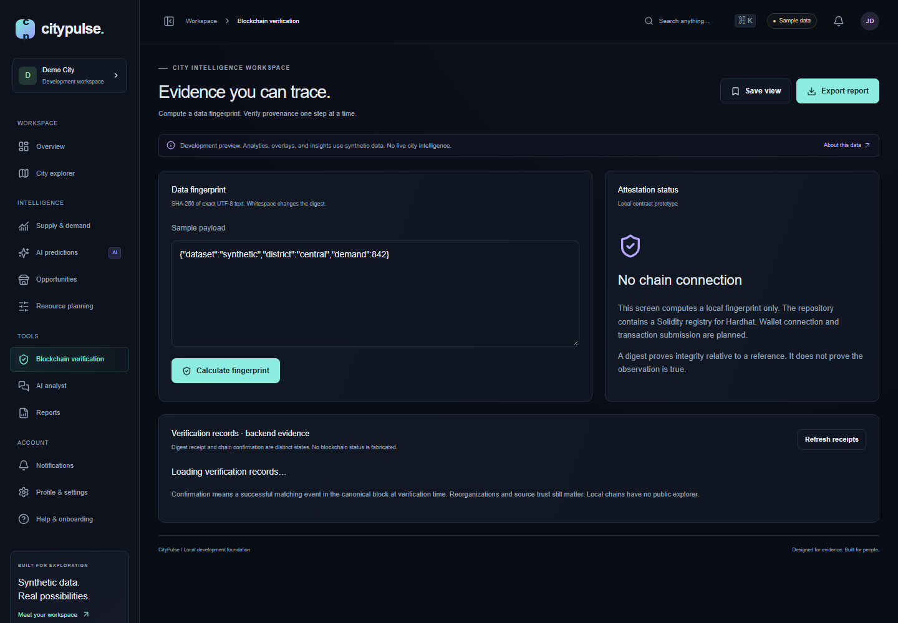
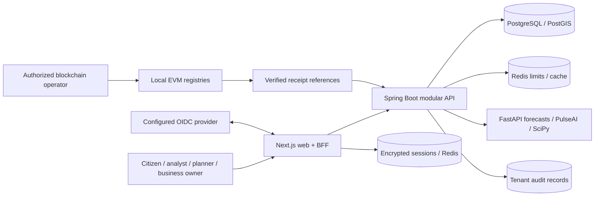
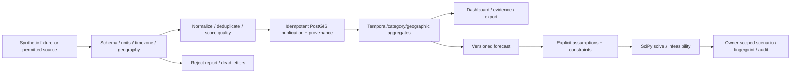
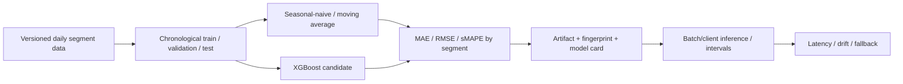
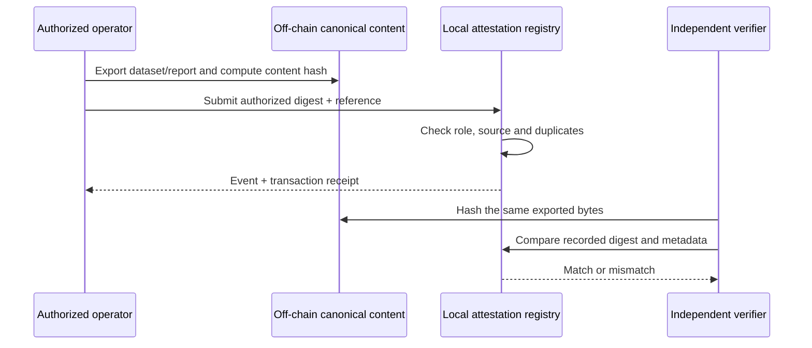

<picture>
  <source media="(prefers-reduced-motion: reduce)" srcset="docs/assets/citypulse-header-static.svg">
  
</picture>

<p align="center">
  <a href="https://github.com/manikantbindass/CityPulse/actions/workflows/ci.yml"></a>
  <a href="https://github.com/manikantbindass/CityPulse/actions/workflows/security.yml"></a>
  <a href="https://github.com/manikantbindass/CityPulse/actions/workflows/platform.yml"></a>
</p>

<p align="center"><strong>Urban supply and demand, understood through AI and verifiable evidence.</strong><br>From observations and provenance to forecasts, constrained decisions, and independent integrity checks.</p>

> **Working development application.** CityPulse has locally runnable Next.js, Spring Boot and FastAPI services, PostGIS migrations, a tested local-chain demonstration, and a real SciPy decision engine. Dashboard samples and reproducible benchmarks are explicitly synthetic. No live city feed, public deployment, guaranteed profit, independent security audit or compliance certification is claimed. AWS infrastructure is code, not a deployed environment.

[Release validation and reproducible end-to-end journey](docs/release/README.md) records verified features, skipped checks, security findings and remaining release gates. The full PDF and PowerPoint are now committed on the default branch.

[Quick start](#quick-start) · [Screenshots](#running-application) · [Architecture](#system-architecture) · [API](#api-documentation) · [Security](#security-architecture) · [Benchmarks](#testing-and-benchmarks) · [Reports](#reports-and-presentation) · [Contribute](#contributing)

## The problem

A growing city can have surplus inventory in one district and unmet demand in another. Separate spreadsheets, incompatible geographic units and incomplete observations make those gaps hard to explain. A forecast without uncertainty or provenance can make a decision look more certain than its evidence supports.

CityPulse connects **where**, **when**, **how much** and **which source**. It helps planners, analysts and business owners inspect observations, compare districts and test resource constraints before acting. Blockchain attestations establish integrity of selected hashes; they do not establish that the original observation was true.

## Feature showcase

| Capability              | Implemented behavior                                                                                                             | Boundary                                                            |
| ----------------------- | -------------------------------------------------------------------------------------------------------------------------------- | ------------------------------------------------------------------- |
| City intelligence       | Cities, zones, businesses, observations, inventories, history and gap calculations                                               | Authorized API records; seed dashboards remain labeled samples      |
| Geospatial exploration  | MapLibre overlays, district comparisons, explicit coordinates, categories and units                                              | Supplied geometry; no invented road network or travel time          |
| Forecasting             | Chronological evaluation, seasonal-naive/moving-average baselines, model comparison, intervals and versioned jobs                | Synthetic reproducible demonstration; see measured segment results  |
| Decision lab            | Opportunity scores, LP/MILP redistribution, budget/capacity/fairness constraints, infeasibility and what-if comparisons          | Assumptions and forecasts remain separate from observations         |
| Saved scenarios         | Tenant/owner-scoped snapshots, saved runs, export, fingerprints and reproduction                                                 | Persistence requires the Java API; local solver runs are unsaved    |
| PulseAI                 | Read-only evidence tools, citations, sessions, provider abstraction and safe evidence fallback                                   | No arbitrary generated SQL; absent evidence stays absent            |
| Verification            | Authorized-source and dataset registries, digest checks, role tests, local receipts and report verification                      | Local EVM demonstration; testnet deployment is opt-in               |
| Identity and governance | OIDC/PKCE sessions, optional provider MFA assurance, membership/scopes, tenant authorization, audit, rate limits and idempotency | Real IdP enrollment and production operations require configuration |
| Platform                | Health probes, Compose, CI/scans/SBOMs, telemetry configuration and AWS Terraform modules                                        | No paid cloud resources are provisioned automatically               |

## Running application

Real captures from the local application, not design mockups. The web UI is running with explicitly labeled development data. Full Java/database integration is exercised in Linux CI; the local Docker Desktop engine has been unavailable. Screenshots show the state they actually rendered, including unavailable-backend states.







See [frontend routes and behavior](docs/frontend.md), [PulseAI](docs/pulseai.md), and the [decision engine](docs/decision-engine.md).

## Technology stack


React, Tailwind CSS, Radix/shadcn-style controls, TanStack Query, Zustand, Recharts, MapLibre/deck.gl, Spring Security/Data JPA/Flyway, Redis, scikit-learn/XGBoost/SciPy, OpenZeppelin/Ethers, Docker, OpenTelemetry, Prometheus/Grafana, Terraform and AWS ECS. Reserved directories do not imply deployed services.

## System architecture



Domain services are separated from controllers and persistence. Identity, registry, ingestion/catalog, analytics, forecasting, verification, reporting and audit are bounded contexts inside a modular system. [C4 context/container/component/deployment diagrams](docs/architecture/README.md) and [ADRs](docs/architecture/decisions/README.md) explain the tradeoffs.

### End-to-end data flow



### AI model pipeline



See the [model card](docs/model-card.md), [measured evaluation](docs/reports/model-evaluation.json), and [training guide](docs/model-card.md). Evaluation is evidence about those datasets and segments, not a claim of real-city accuracy.

### Blockchain verification flow



Raw personal data stays off-chain. Immutability does not allow deletion of an attestation. [Deployment, threat model and independent report verification](docs/blockchain.md) document the exact implemented boundary. No explorer link is advertised without a real deployment.

## Product modules

The application includes marketing/features, sign-in, analytics, city explorer, supply and demand, forecasts, opportunity exploration, resource planning, verification, PulseAI, reports, notifications, profile/settings, administration and help/onboarding. Navigation visibility helps the user; server permissions determine access.

### Interactive dashboards

The decision workspace provides Business Opportunity Explorer, Supply-Demand Imbalance Map, Resource Optimization Simulator, District Comparison Tool, Scenario Comparison Dashboard, Investment Planning Workspace and Decision Explanation Panel. Budget, capacity, coverage, objectives and assumptions are inspectable. Forecast intervals express uncertainty; scores do not predict profit. Exports preserve provenance and reproduction fingerprints.

## Repository structure

<details>
<summary>Explore the CityPulse monorepo</summary>

```text
CityPulse/
├── apps/                  # Next.js web; admin extraction boundary
├── services/              # Spring API, FastAPI AI, ingestion CLI; reporting boundary
├── packages/              # UI/config/typed contract boundaries
├── blockchain/            # Solidity registries, Hardhat tests, deploy/verify scripts
├── data/                  # Synthetic CSV/JSON/GeoJSON, schemas, fixtures
├── infrastructure/
│   ├── docker/            # Runtime roles and public RDS trust bundle
│   ├── monitoring/        # Collector, Prometheus, Tempo, Grafana
│   ├── terraform/         # AWS network/data/compute modules; no apply performed
│   └── kubernetes/        # Planned optional alternative
├── docs/                  # PRD, ADRs, API, security, operations, assets and documents
├── tests/                 # Cross-service guidance and bounded k6 workloads
├── scripts/               # Setup, ingestion, smoke, model and verification tools
├── .github/workflows/     # CI, security, platform and manual packaging
├── .env.example
└── compose.yaml
```

[PRD](docs/PRD.md) · [Data dictionary](docs/data-dictionary.md) · [Configuration and developer guide](docs/development.md)

</details>

## Quick start

Prerequisites: Git, Docker Engine/Desktop with Linux containers and Compose v2, and Python 3.12–3.14 for the cross-platform launcher. Docker builds install application dependencies. Native development additionally needs Node 22.14+ or 24, npm, Java 21+ and Maven 3.9+. Initial dependency/image downloads require internet.

```bash
git clone https://github.com/manikantbindass/CityPulse.git
cd CityPulse
python scripts/dev_stack.py up
```

The launcher generates `.env` only when missing, preserves existing configuration, builds the stack, waits for health and runs real smoke checks. It stops on a failed prerequisite or check.

```bash
# Include a local test blockchain and the optional telemetry stack.
python scripts/dev_stack.py up --chain --observability
python scripts/dev_stack.py status --chain --observability
python scripts/dev_stack.py down --chain --observability
```

Default app: `http://localhost:3000`; API readiness: `http://localhost:8080/readyz`; AI: `http://localhost:8000/health`. Optional Grafana: `http://localhost:3050` (admin; generated password in ignored `.env`), Prometheus: `http://localhost:9090`, local chain: `http://localhost:8545`. All published development ports bind to loopback. Stopping preserves named volumes.

### Native development commands

```bash
npm ci
npm run dev
mvn -f services/api/pom.xml spring-boot:run -Dspring-boot.run.profiles=local
python -m venv services/ai-engine/.venv
# Activate the venv using your shell, then:
pip install -r services/ai-engine/requirements-dev.lock
pip install --no-deps -e services/ai-engine
uvicorn citypulse_ai.main:app --host 127.0.0.1 --port 8000 --no-access-log
python scripts/data_pipeline.py demo
npm run demo:ephemeral --workspace blockchain
```

Native services need the environment variables and dependency services described in the [developer guide](docs/development.md). Source `.env` using your shell or IDE; never commit it. The one-command Docker path handles dependency services and environment injection.

## Configuration

| Area                 | Variables / behavior                                                                                                                        |
| -------------------- | ------------------------------------------------------------------------------------------------------------------------------------------- |
| Local dependencies   | `POSTGRES_DB`, `POSTGRES_USER`, `POSTGRES_PASSWORD`, distinct `DATABASE_PASSWORD`, `REDIS_PASSWORD`, `LOCAL_API_TOKEN`                      |
| Service routing      | `DATABASE_URL`, `REDIS_HOST`, `AI_BASE_URL`, `API_BASE_URL`; cloud DB/Redis use TLS                                                         |
| Identity             | `OIDC_ISSUER_URI`, `OIDC_AUDIENCE`, `OIDC_CLIENT_ID`, `OIDC_CLIENT_SECRET`, HTTPS `WEB_ORIGIN`, optional exact `OIDC_REQUIRED_ACR`          |
| Server sessions      | Private `SESSION_REDIS_URL`, random base64 32-byte `SESSION_ENCRYPTION_KEY`; Secure/HttpOnly cookies, short TTL, no persisted refresh token |
| Explicit local modes | `PULSEAI_LOCAL_PREVIEW`, `DECISION_LOCAL_PREVIEW`; never production authorization substitutes                                               |
| Optional provider    | `PULSEAI_PROVIDER=disabled` by default; model/URL/key/cost bounds required before enabling                                                  |
| Telemetry            | `OTEL_EXPORTER_OTLP_ENDPOINT`, API `OTEL_EXPORTER_OTLP_TRACES_ENDPOINT`, `TRACING_SAMPLE_PROBABILITY`, `DB_POOL_SIZE`                       |
| Testnet              | Explicit RPC, signer and real contract metadata; no testnet/private signer preconfigured                                                    |

See [.env.example](.env.example), [security operations](docs/security/operations.md) and [deployment](docs/operations/deployment.md). Secrets enter runtime configuration; no real credentials are included in examples.

## Data sources and limitations

Synthetic examples include Bengaluru and Pune with explicit `Asia/Kolkata` time zones, INR and kg where applicable. CSV, JSON and GeoJSON ingestion tracks timestamps, source metadata, licensing, schema, quality, duplicates and provenance. An official API is usable only when accessible, licensed and configured; access to real-time city data is never implied.

Missing supply/demand is unknown, not zero. Stocks are distinct from time-window flows. Forecasts are not observations. Optimization uses supplied lane constraints rather than inventing routes. A matching blockchain digest proves byte integrity, not source truth. [Ingestion](docs/ingestion.md), [data policy](docs/data-policy.md), [canonical schema](docs/data-dictionary.md), and [decision assumptions](docs/decision-engine.md) provide detail.

## API documentation

[Backend behavior](docs/api/backend.md) · [Typed contracts](packages/contracts/README.md) · [PulseAI tools](docs/pulseai.md) · [Forecasts](docs/model-card.md) · [Decision scenarios](docs/decision-engine.md)

Protected APIs require an accepted token and active tenant membership. Error/status behavior, pagination, idempotency and permissions are documented with actual endpoints. API OpenAPI is authenticated at `/v3/api-docs`; Swagger UI is disabled. FastAPI exposes its schema at `/openapi.json` on its private service boundary.

## Security architecture

OIDC code flow with PKCE/state/nonce and signature verification; encrypted server sessions; membership-narrowed scopes; tenant and owner predicates; strict imports; bounded streaming bodies; safe CSV export; security headers; rate limiting; append-only runtime audit privileges; restricted DB/container roles; dependency/secret/image scans and CodeQL.

[Trust boundaries and access matrix](docs/security/architecture.md) · [STRIDE threat model](docs/security/threat-model.md) · [Verification evidence](docs/security/verification.md) · [Disclosure policy](SECURITY.md) · [Incident and rotation runbooks](docs/security/operations.md)

Optional MFA must be enabled at the actual provider and its configured assurance checked in both identity and access tokens. External IdP enrollment, penetration testing, professional contract audit, Slither and production restore drills remain unverified. The Hardhat Zod 3 development advisory is tracked; production dependency audits remain enforced. The [SOC 2-style control mapping](docs/security/controls.md) is an illustrative engineering exercise, not certification.

## Deployment and scalability

[Progressive deployment](docs/operations/deployment.md) · [Operations and SLOs](docs/operations/observability.md) · [Scaling and cost assumptions](docs/operations/scaling.md) · [Recovery](docs/operations/recovery.md) · [AWS infrastructure](infrastructure/terraform/README.md)

Compose supports application dependencies, health/startup checks and an optional local chain/monitoring stack. CI builds, tests and scans; CycloneDX SBOMs accompany image reports. A manual release workflow packages SHA-versioned images. Preview environments are designed as isolated synthetic-data stacks, not advertised live URLs.

AWS code defines private Fargate workloads, HTTPS ALB, RDS/PostGIS setup path, TLS Redis, encrypted persistent AI storage, a versioned private dataset/report bucket and optional SQS/DLQ infrastructure. No cloud apply has occurred. Kubernetes, asynchronous queue consumers and distributed AI persistence remain future work. Web/API can scale within connection budgets; AI remains a single writer until its SQLite persistence is replaced.

## Testing and benchmarks

```bash
npm run lint && npm run typecheck
npm test --workspace apps/web
npm run build
npm run test:e2e --workspace apps/web
mvn -f services/api/pom.xml verify
python -m pytest services/ai-engine/tests
python -m unittest discover -s services/ingestion/tests -v
npm run test:contracts
python scripts/check_repository.py
python scripts/check_readme.py
```

The verified security-phase baseline (`72c767b`) passed **25 Java tests, 46 AI tests, 13 web unit tests, 16 desktop/mobile browser tests, six ingestion tests and four contract tests**. These are revision-specific results; current workflow logs are authoritative for later changes. Linux CI exercises PostGIS tenant isolation, actual cross-service forecasting/PulseAI/scenarios, data publication and runtime database grants. Accessibility checks include automated WCAG checks, keyboard behavior, mobile layouts and reduced motion.

[Measured model evaluation](docs/reports/model-evaluation.json) · [Synthetic decision benchmarks](docs/reports/decision-evaluation.json) · [Browser performance observations](docs/reports/web-performance.json) · [Load-test method and results](docs/operations/scaling.md)

Measurements are bounded local/CI experiments. No production throughput, availability, coverage percentage or accuracy is invented. Local Docker limitations and unrun deployment/restore scenarios are recorded. k6 thresholds fail the workload when violated; they do not certify a production SLO.

## Reports and presentation

[Download technical report PDF](docs/reports/CityPulse-Technical-Report.pdf) · [Download project presentation PPTX](docs/presentations/CityPulse-Project-Presentation.pptx)

The **79-page technical report** and **33-slide presentation** document inspected application snapshot `723bb90` and measured synthetic experiments. Both include editable sources, architecture diagrams, real application screenshots, limitations and references. [Report regeneration](docs/reports/README.md) · [Presentation regeneration](docs/presentations/README.md). Application changes after that snapshot require a fresh evidence review.

## Roadmap

- [x] Runnable web/API/AI foundation and canonical PostGIS data model
- [x] Reproducible ingestion, forecasts, local attestation and evidence-grounded PulseAI
- [x] Constrained decision engine, saved scenarios and security hardening
- [x] Progressive deployment code, telemetry configuration and reproducible load workloads
- [ ] Licensed city feeds with operational data-quality ownership
- [ ] Real IdP/MFA rollout, restore rehearsal and cloud deployment validation
- [ ] Distributed forecast/job persistence, transactional outbox and queue workers
- [ ] Capacity certification, external security review and production SLO history
- [x] Evidence-grounded technical report and editable project presentation

## FAQ

**Is this live city intelligence?** No. Sample interfaces and reproducible demos use labeled synthetic data. Authorized database records are retrieved only through the real services.

**Does a score guarantee a successful business?** No. Scores reflect configured assumptions and observed gaps. They are not investment advice or profit predictions.

**Does blockchain validate the source?** It records authorized attestations and lets another party compare content hashes. Source quality still needs independent validation.

**Does startup spend cloud money?** The local launcher does not. Terraform is not applied automatically; an operator must review the plan, credentials, secrets and regional costs before any deployment.

## Contributing

Read [CONTRIBUTING.md](CONTRIBUTING.md), [CODE_OF_CONDUCT.md](CODE_OF_CONDUCT.md), the [PRD](docs/PRD.md), and the relevant ADR before changing a boundary. Use `citypulse/` feature branches, Conventional Commits and a PR with verification evidence. Keep data mode, limitations and provenance explicit. Never commit secrets or personal datasets. Security reports follow [SECURITY.md](SECURITY.md).

## License and acknowledgments

A repository license has not been explicitly selected. No LICENSE is invented, and public visibility does not grant an open-source license. Obtain permission before redistribution. Third-party dependencies retain their respective licenses.

Built with the open-source projects named in the stack, including Next.js/React, Spring, PostgreSQL/PostGIS, OpenTelemetry, SciPy/scikit-learn, MapLibre and OpenZeppelin. Synthetic fixtures are authored for reproducible development; source metadata records the licensing terms of imported datasets. Branding SVGs are local, script-free and lightweight, with readable static and reduced-motion alternatives.

[Static header](docs/assets/citypulse-header-static.svg) · [Static footer](docs/assets/citypulse-footer-static.svg) · [Changelog](CHANGELOG.md)

<picture>
  <source media="(prefers-reduced-motion: reduce)" srcset="docs/assets/citypulse-footer-static.svg">
  
</picture>
