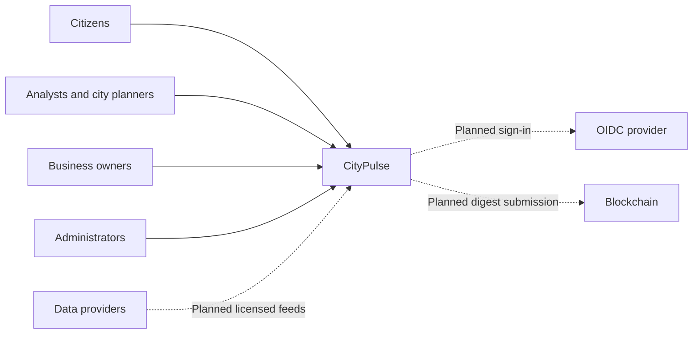
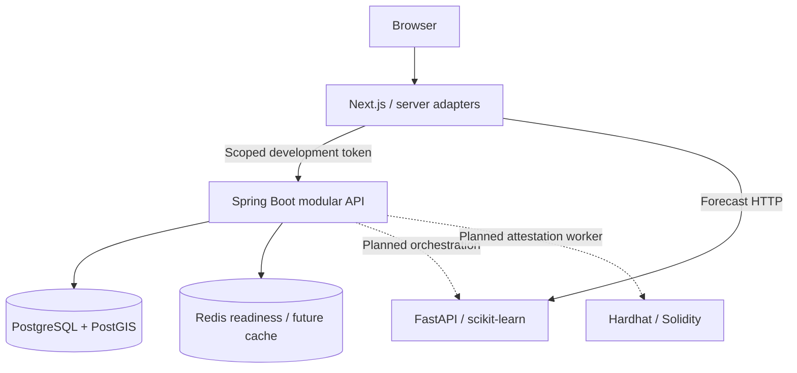
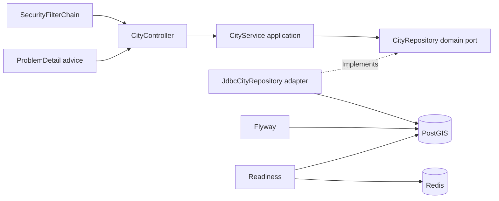
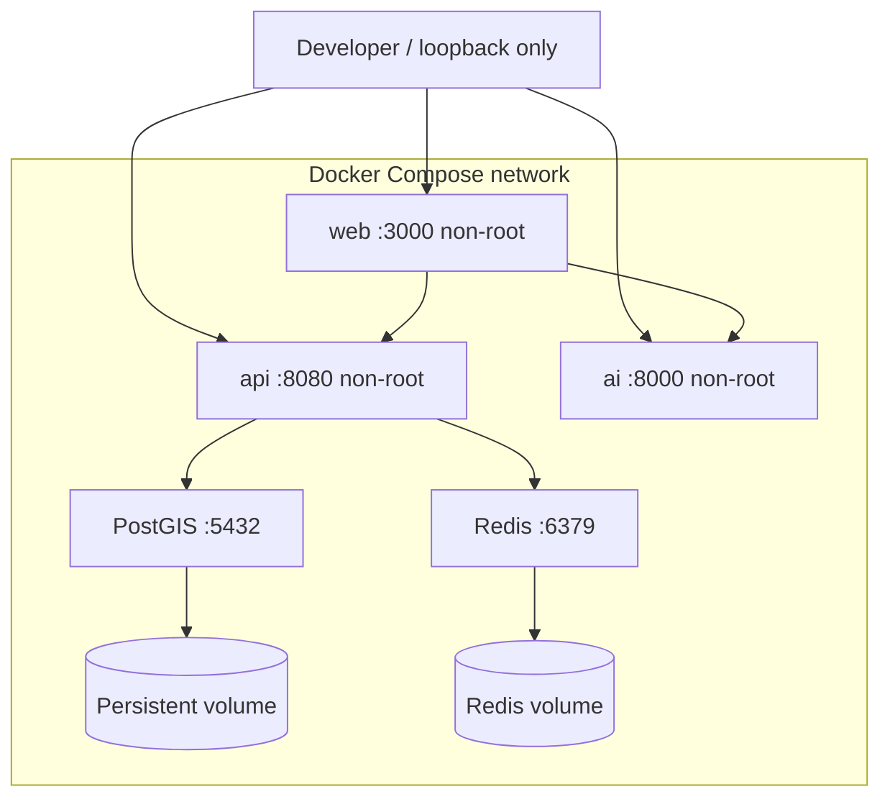
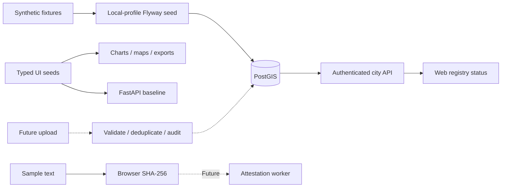

# Architecture

CityPulse starts with a modular Spring Boot API, a separate Python inference service, and Next.js. PostgreSQL/PostGIS is authoritative. Redis is available for bounded caches and future rate limits; it holds no correctness state. No broker runs because no asynchronous production pipeline exists yet.

## Bounded contexts

| Context               | Ownership                         | Current boundary                          |
| --------------------- | --------------------------------- | ----------------------------------------- |
| Identity and access   | Subjects, scopes, future tenants  | Spring Security local token / OIDC        |
| Geographic registry   | Cities, zones, business locations | Domain, application, JDBC and HTTP layers |
| Ingestion and catalog | Sources, validation, idempotency  | SQL schema; writes planned                |
| Supply and demand     | Compatible aggregates, gaps       | Seed frontend; query service planned      |
| AI forecasting        | Model versions, evaluation        | FastAPI baseline; recommendations planned |
| Attestation           | Digests, receipts, chain state    | Local Solidity; integration planned       |
| Reporting and audit   | Exports, audit trail              | Seed CSV and schema; job service planned  |

## C4 context

## C4 containers

## C4 components

## Deployment: implemented local topology

## Data flow

## Fault isolation and scaling

Keep modules in one deployment until measured volume or ownership justifies extraction. Add bounded database-backed import jobs first. For multiple independent consumers and replay, write an outbox in the observation transaction, publish with bounded retries, and introduce Redpanda. Use at-least-once delivery and consumer deduplication; broker settings do not imply exactly-once business effects.

Future public deployment requires tenant authorization, OIDC web sessions, audience checks, rate limits, trace propagation, structured logs, metrics, backup restoration drills and restricted audit writes. Readiness checks database and Redis; liveness checks process state. The web renders without registry connectivity. AI failures remain isolated.

Scale stateless API replicas after a single migration job. Train real models offline with versioned artifacts. The current bounded linear fit is for local experimentation only. Kubernetes/Terraform directories are reserved with no deployed resources.

See [ADRs](decisions/README.md), [API](../api/README.md), [data policy](../data-policy.md) and [PRD](../PRD.md).
