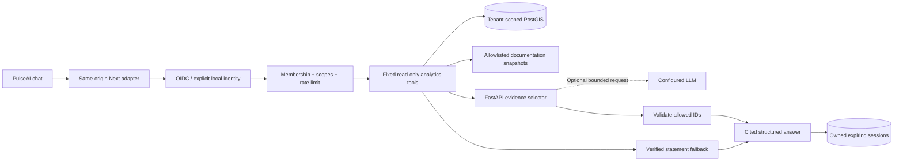

# PulseAI: evidence-grounded analyst

PulseAI is a read-only analyst at `/analyst`. It retrieves actual tenant-authorized
database records. The dashboard's seeded district figures never substitute for
missing records. The default local fixture is synthetic, with rice demand and no
matching supply; PulseAI explicitly reports that a shortage cannot be established.

## Run

```sh
python scripts/setup-env.py
docker compose up --build -d
python scripts/smoke.py
docker compose down
```

Open `http://localhost:3000/analyst`. Compose explicitly enables a shared local
development identity. Do not expose this configuration publicly. Outside Compose,
set `API_BASE_URL` and `PULSEAI_LOCAL_PREVIEW=true` only for local development. The
adapter otherwise requires the caller's Bearer access token; it never trusts a
browser-supplied tenant or role. A production browser sign-in/session flow remains
pending: the existing login page is not an OIDC client. Direct API clients can use
the existing OIDC resource-server configuration.

## Contract

All routes require `analytics:read` **and** `data:read`, narrowed by active database
membership on every request, including history. Tenant comes from the validated
identity. A session additionally belongs to the subject that created it.

| Method | Route under `/api/v1/pulseai` | Behavior                                                               |
| ------ | ----------------------------- | ---------------------------------------------------------------------- |
| POST   | `/sessions`                   | Create an owned seven-day session; maximum 30 active sessions          |
| GET    | `/sessions`                   | List up to 30 owned sessions                                           |
| GET    | `/sessions/{id}`              | Up to 20 stored question/answer pairs, oldest first                    |
| DELETE | `/sessions/{id}`              | Delete owned session and cascade messages                              |
| POST   | `/sessions/{id}/messages`     | Validate filters, retrieve evidence, select statements, persist answer |

Message body:

```json
{
  "question": "Explain source provenance and missing supply",
  "cityId": "10000000-0000-0000-0000-000000000001",
  "from": "2026-01-01T00:00:00Z",
  "to": "2026-01-02T00:00:00Z",
  "commodity": "rice",
  "unit": "kg",
  "forecastId": null,
  "comparisonCommodity": null
}
```

A second optional commodity can be compared only in the same measurement unit. Positive gaps are investigation candidates, never investment recommendations.

The interval is positive, at most 366 days and half-open. Only observations fully
contained in it are considered. Units are `count`, `kg`, `litre`, `kwh`, or `trip`.
Question length is 2,000 characters. Session writes lock the owned session to enforce
the 20-message bound. Unknown/foreign/expired session or city returns 404; revoked
scope returns 403. Bean Validation returns the existing problem-details schema.
Ten API requests/minute per subject/tenant apply to the PulseAI namespace; Redis
failure rejects requests. Existing global abuse controls remain in place elsewhere.

Each answer includes statements with actual observation UUIDs or source/forecast
UUIDs, documentation paths and SHA-256 fingerprints, limitations, related views,
and follow-up prompts. Record references are identifiers, not public URLs. The
authorized forecast endpoint provides the selected forecast in full.

## Retrieval and truth boundary

1. Spring executes fixed, parameterized, tenant-filtered read-only queries. There
   is no model SQL execution, arbitrary tool name, network retrieval, or file path.
2. Quantities group by zone, exact observation interval, source mode and unit.
   Demand and supply must both be present before a gap is calculated. Inventory
   stocks are never treated as supply flows. Multiple sources are summed as
   reported; cross-source coverage and deduplication must be assessed upstream.
3. At most 12 latest interval groups and six source references are returned. This
   bounded evidence window is not a citywide ranking or a representative sample.
4. Optional forecast UUID retrieval is tenant-checked. Forecast segment labels and
   interval method come from the stored result. A slug-labelled forecast is not
   silently attributed to a registry city UUID.
5. Documentation retrieval searches a build-time allowlist of `docs/model-card.md`
   and `docs/data-policy.md` snapshots. It returns bounded plain-text excerpts and
   content hashes, never interprets embedded instructions, and follows no links.
6. Optional LLM output is only a JSON list of allowed statement IDs. Both Python
   and Java validate the IDs. Factual prose and citations are constructed by Java;
   provider-generated claims, instructions and citations cannot enter the answer.
   Documentation and source text are untrusted and rendered as escaped text.

The assistant can compare observed intervals and zones for up to two explicit commodities
and one unit, explain source metadata and stored forecast methodology, and expose
related geography/forecast views. Citywide cross-category rankings, inferred expansion
hotspots, causal explanations, fairness-aware allocations and autonomous dashboard
changes are **not implemented**. It declines conclusions unsupported by the selected
records. It does not infer filters from natural language; use the context controls.
Follow-up prompts re-run the same protected retrieval with the current filters.

## Optional model and costs

The default `PULSEAI_PROVIDER=disabled` makes zero external model calls. FastAPI
failure also falls back to verified statements. To enable a compatible provider:

```dotenv
PULSEAI_PROVIDER=openai-compatible
PULSEAI_PROVIDER_URL=https://api.openai.com/v1
PULSEAI_MODEL=<operator-selected compatible model>
PULSEAI_API_KEY=<secret supplied at runtime>
PULSEAI_MAX_USD_PER_MILLION_TOKENS=<ceiling covering BOTH input and output>
```

The adapter uses Chat Completions structured JSON output, `store:false`, an output
cap of 256 tokens, HTTPS, an eight-second timeout, no redirects and no retry.
Model/provider compatibility must be tested by the operator; no paid credentials
were used for the reproducible tests. See the [official structured-output
contract](https://developers.openai.com/api/docs/guides/structured-outputs?api-mode=chat).

SQLite atomically reserves at most 20 external attempts and 50,000 conservatively
estimated tokens per subject/tenant/UTC day. Each reservation uses the UTF-8 payload
byte count plus 2,000 tokens for schema, instructions and output. Requests above
16,000 reserved tokens fall back. Failed/ambiguous calls retain their reservation.
The configured price ceiling must be positive and at most USD 20 per million
tokens: with valid operator-supplied prices the token ceiling corresponds to at
most USD 1/day/subject, excluding provider-specific fees. This is an application
estimate, not a billing guarantee. Set provider-side project budgets as well; there
is no global billing reconciliation or automatic price lookup. Disabling the
provider gives deterministic zero external cost.

No raw provider output, question or key is logged by this code. Common email and
Bearer/API-key patterns are redacted before storage and provider transmission;
this is not complete PII detection. Users must avoid sensitive personal data.
Only generated aggregate statements and a redacted question go to the provider,
not raw rows, actor identifiers or complete documentation. Actor IDs are hashed in
the daily budget ledger. Ensure upstream access logs do not record bodies/tokens.

## Retention, operations and limits

Sessions expire after seven days; reads reject expired sessions immediately. An
hourly maintenance task physically deletes expired sessions/messages. Budget rows
older than eight days are removed on reservation. Database backups follow the
deployment's separate retention policy. Ownership and scope checks apply to stored
answers; source-record edits are not retroactively reflected in history, so an
answer is a dated snapshot. Delete a conversation to remove its stored messages.

Answers are buffered until all evidence IDs validate. This implementation does not
stream unvalidated provider tokens. Loading state is accessible; there is no fake
typing animation. Provider requests have an eight-second timeout, Java has ten
seconds and the web adapter twenty seconds. Actual local/CI measurements are
recorded separately; these timeouts are not latency SLOs.

## Validation

Python tests cover authorization, schema rejection, injected provider responses,
unknown/repeated statement IDs, credential-free fallback and owner-separated
budgets. Java tests cover ownership predicates, redaction and allowlisted document
fingerprints; Testcontainers exercises stored evidence, session deletion and role
revocation against PostGIS. Compose smoke checks Java→Python and Next→Java paths.
Playwright exercises error/empty states, suggestions, deletion, mobile width and
axe accessibility. Browser contract fixtures intentionally contain no invented
analytical facts. An actual external provider evaluation and a formal security
audit remain pending.

## Architecture



Threat controls include tenant/actor predicates against identifier guessing,
server-side membership checks against role spoofing, allowlisted files against path
traversal, parameterized SQL against injection, ID-only model output against prompt
injection, explicit local-preview configuration against anonymous token delegation,
same-origin web mutations, bounded payload/context/session/request/token usage and
no raw source HTML rendering. Compromised server credentials, provider compromise,
operator price misconfiguration and incomplete source data remain operational risks.
