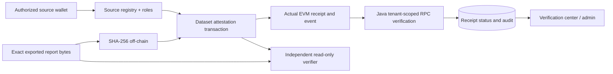

This implementation is a local prototype, not an audited contract system. It stores public digests and hashed references only. It never stores raw private observations or personal data on chain.

## Modules

| Contract                   | Responsibility                                                                                                   |
| -------------------------- | ---------------------------------------------------------------------------------------------------------------- |
| AuthorizedSourceRegistry   | Registrar binds a wallet to an organization digest and metadata digest, and can revoke future authorization      |
| DatasetAttestationRegistry | Authorized attester records event/content/reference hashes and a use-case kind; emergency pauser can stop writes |
| VerificationRecord         | Read-only comparison of a known attestation against an independently calculated content digest                   |

OpenZeppelin AccessControlDefaultAdminRules uses a delayed two-step default-admin transfer. Registrar, attester and pauser roles remain distinct. Production administration should use a separately secured multisig. Roles and registration establish administrative authority, not the truth of a real-world identity or dataset.

Kinds: 1 dataset, 2 supply observation, 3 authorized audit event, 4 approved allocation, 5 report. A kind-4 record is an attester's assertion of an off-chain approval; the contract does not independently run a municipal approval workflow. A separate approval registry is not added without that workflow.

Duplicate event IDs are rejected per submitter. Attestation IDs include chain ID, contract address, sender and event ID, avoiding cross-deployment ambiguity. A repeated content hash may be legitimate for a new publication/event, so duplicate protection operates on event identity rather than prohibiting all content reuse. No meta-transactions or arbitrary signatures are accepted, reducing replay surface.

## Local demonstration

```sh
npm ci
# Terminal 1: funded development accounts on loopback only
npm run node --workspace blockchain
# Terminal 2: deploy, attest a synthetic CSV, read receipt and verify/tamper-check
npm run demo:local --workspace blockchain
npm run verify:report --workspace blockchain
```

For a self-contained ephemeral chain without an RPC server, run `npm run demo:ephemeral --workspace blockchain`. This deploys, transacts, checks the real receipt, and reads the independent verifier during the same run; the chain ends with the process and cannot be queried later. [Captured local evidence](../../blockchain-local-demo.json) records an actual ephemeral run. It is not a public deployment.

[Persistent local demo evidence](../../blockchain-persistent-demo.json) also records a separate-process report verification on local port 8547. Set `LOCAL_CHAIN_RPC_URL` to select a nondefault loopback RPC when port 8545 is in use.

The demo restricts itself to chain 31337 and creates a report in `.data/blockchain/sample-report.csv`. It estimates gas before sending, waits for the actual receipt, records gas used, transaction/block hashes, addresses, chain ID and contract version, and independently reads the verification contract. Tampered bytes must return false. Keys printed by Hardhat are disposable development keys and must never secure public assets. Chain restart invalidates old local deployments; the independent verifier checks network and deployed bytecode.

Exact-byte SHA-256 is used for file content. UTF-8 strings must preserve newlines and whitespace. Off-chain reference strings are SHA-256 hashed before submission, avoiding accidental publication of signed URLs or private paths. Keep a controlled off-chain mapping from reference digest to storage location. A digest of predictable personal data can still leak information through guessing; do not attest personal records without a reviewed privacy design.

## Backend and UI

Configure the API from the real local result manifest:

```text
BLOCKCHAIN_RPC_URL=http://localhost:8545
BLOCKCHAIN_CHAIN_ID=31337
ATTESTATION_CONTRACT_ADDRESS=<DatasetAttestationRegistry address from the demo>
ATTESTATION_EVENT_TOPIC=<eventTopic from the demo>
ATTESTATION_CONTRACT_VERSION=1.0.0
```

The Java backend never needs a private key. Create a digest receipt using `POST /api/v1/verifications` with `{payload:<exact report text>}` and an Idempotency-Key. Submit `{transactionHash,attestationId}` to `POST /api/v1/verifications/{id}/receipt`. Server-side scope and tenant checks precede RPC verification. The server verifies the configured chain ID, successful receipt, registry address, event signature, attestation ID, digest topic and canonical block hash before persisting `CHAIN_CONFIRMED`. Unconfigured RPC returns 503; pending, failed or mismatched evidence returns 409.

Set `CITYPULSE_API_URL` and `LOCAL_API_TOKEN` in the demo shell to perform those two backend steps automatically after the actual chain transaction. The CLI reports backend failure independently; it never erases or falsely confirms a chain transaction. The verification center and administrator console show backend receipt records, or an explicit unavailable/empty state. Local networks get no fabricated explorer link.

For Compose API access to a host Hardhat process, configure a reachable private host address and firewall deliberately; the provided node stays loopback-only. A host-side API is the simplest local demo. A Docker chain profile is not deployed automatically.

## Optional testnet deployment

Use `npm run deploy:testnet --workspace blockchain` only after setting TESTNET_RPC_URL, TESTNET_PRIVATE_KEY and CONTRACT_ADMIN_ADDRESS in the shell or an ignored environment source. The network config uses Hardhat configuration variables; it does not read committed keys. Never reuse local keys. No public deployment is performed by this task and no explorer URL is invented. Configure an explorer only after verifying chain ID, transaction hash and deployment address. Use faucet test funds only and understand gas before sending.

## Threat model

| Threat                      | Control and limit                                                                                                   |
| --------------------------- | ------------------------------------------------------------------------------------------------------------------- |
| Unauthorized writer         | OpenZeppelin roles plus active source registration; compromised authorized keys remain a risk                       |
| Role takeover               | Delayed two-step default admin transfer; use multisig and separate operational keys                                 |
| Duplicate/replayed event    | Per-sender event ID uniqueness and chain/contract domain separation                                                 |
| Invalid proof/tampered file | Exact digest comparison, nonzero values, deployment and event matching                                              |
| RPC fabrication             | Trusted configured RPC required; public deployments need independent providers and stronger finality policy         |
| Reorganization              | Canonical block checked at submission; later revalidation/finality tracking remains a production requirement        |
| Data deletion               | Immutable digests/events cannot be erased; delete off-chain content under policy and disclose permanent commitments |
| Metadata leakage            | Hash references, prohibit secrets/PII; hashes may still reveal low-entropy inputs                                   |
| Gas griefing                | Fixed-size hash inputs, no unbounded on-chain loops or external value transfers                                     |
| Source revocation           | Blocks future attestations without rewriting history; old attestations remain verifiable                            |

No contract holds currency, calls untrusted external addresses with value, uses upgrade proxies, or executes arbitrary payloads. The immutable source-registry dependency is trusted at deployment. Static analysis and tests are partial evidence, not an audit. Public operation requires independent review, signer rotation, multisig runbooks, finality monitoring and incident exercises.



## Static checks

`npm run lint --workspace blockchain` runs Solhint security/style rules. The latest local run reported zero errors and six warnings (gas packing/indexing and workspace import-path resolution). Compilation resolves OpenZeppelin imports and contract tests execute them. Solhint is a limited static check, not a formal proof or an audit. No Slither audit result is claimed.
