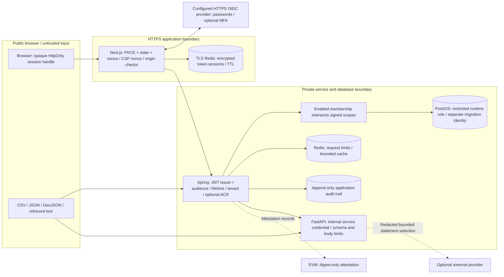

# Security architecture and trust boundaries

This is a development system with implemented safeguards and documented deployment
requirements. No penetration test, independent smart-contract audit, SOC 2 report,
or compliance certification is asserted.

## Authentication, sessions and account lifecycle

Set `WEB_ORIGIN` to an exact HTTPS origin, `OIDC_ISSUER_URI`, a confidential
`OIDC_CLIENT_ID`/`OIDC_CLIENT_SECRET`, and registered redirect
`https://your-origin/api/auth/callback`. `openid-client` performs discovery and
authorization-code processing; code uses S256 PKCE, nonce, state, single-use
five-minute Redis flow handles and explicit signature verification. Redirect URIs
are server configuration, never request parameters. Both identity and access tokens
must be accepted: the API independently validates the access token and active
membership before a session is issued.

MFA is implemented by the identity provider. Set `OIDC_REQUIRED_ACR` to its exact
documented assurance value and configure the provider to place it in both ID and
access tokens; both boundaries reject mismatches. Merely requesting `acr_values`
does not enable MFA. No real provider enrollment was performed by this change.
Use phishing-resistant factors where supported. IdP recovery, verified contacts,
password policies, enrollment and credential resets remain IdP responsibilities.

Sessions use 256-bit random opaque handles in Secure, HttpOnly, SameSite=Lax,
host-only `__Host-` cookies. Access tokens are encrypted with AES-256-GCM in Redis,
never localStorage or browser-readable cookies. Set `SESSION_ENCRYPTION_KEY` to a
base64-encoded random 32-byte secret and `SESSION_REDIS_URL` to a private TLS Redis
endpoint. A deliberately explicit `SESSION_REDIS_ALLOW_LOCAL=true` exists only for
local test stores. Session and token lifetime is capped at one hour, with no refresh
token stored. Expiry requires a new login. API membership rechecks reject disabled
users immediately even if a JWT/session has not expired. Redis failures fail closed.
Login attempts have a shared 100/minute admission limit; enforce per-IP limits at
the trusted edge as well. This code does not trust forwarded IPs for identity.

`POST /api/auth/logout` requires the exact origin, deletes the server session, and
clears cookies. It does not claim to terminate the global IdP session. With no stored
refresh token there is no refresh-token revocation step. For incident-wide
termination invalidate the Redis session namespace and rotate the encryption key.
Provider-issued bearer tokens remain valid until expiry unless the account is
disabled or the IdP performs supported revocation. Configure short token lifetimes.

Accounts are preprovisioned by a tenant administrator against a real IdP subject;
there is no public self-registration or trust in UI demo roles. Only an administrator
can change membership roles/status, and writes are audited. Lifecycle updates take
a per-tenant transaction lock and cannot remove the final enabled administrator or
disable one's own account. The initial administrator must be provisioned through an
operator-controlled bootstrap SQL change; no production bootstrap endpoint exists.

## Access matrix

All private data queries derive tenant identity from the validated JWT. A database
membership can narrow signed scopes, never expand them. Additional object ownership
checks apply to conversations, decision scenarios, snapshots and lane networks.

| Actor                     | Registry   | Data       | Analytics  | Tenant administration |
| ------------------------- | ---------- | ---------- | ---------- | --------------------- |
| Citizen                   | Read       | None       | None       | None                  |
| Business owner / provider | Read       | Read/write | Read       | None                  |
| Analyst / planner         | Read       | Read       | Read/write | None                  |
| Administrator             | Read/write | Read/write | Read/write | Read/write            |

PulseAI requires both data and analytics read scopes; its city picker additionally
requires registry read. Decision execution requires analytics read/write and data
read; source/network registration also requires data write. Scenario exports remain
owner-scoped even for another administrator. Administrative tenant-wide operations
must use their explicit existing routes. Tenant administration is not cross-tenant
platform administration. No default superuser scope is accepted from the browser.

## Input, output and API controls

Web adapters bound streamed request bytes before buffering: 8,000 for PulseAI,
200,000 for forecasts and 512,000 for decisions. Limits also apply when
Content-Length is absent or understated; oversized streams are canceled and return 413. UTF-8 byte and chunk-boundary regressions cover this boundary.

Spring validates DTOs, rejects unknown JSON properties, bounds parser nesting,
number and string sizes, restricts multipart files to one MB/500 JSON observations,
and enforces a streaming body bound even when Content-Length is absent. Local
CSV/GeoJSON ingestion is bounded to ten MB/100,000 rows, rejects duplicate CSV
headers, ragged rows and unknown PII-prone columns. It does not execute formulas,
archives or documents. Spreadsheet export neutralizes formula prefixes including
leading whitespace. Never open unsanitized source CSV files in spreadsheet software.

Server-side parameterized SQL, UUID references, enum/sort allowlists and explicit
geographic/temporal bounds constrain data access. Retrieval is read-only for PulseAI;
the model cannot execute SQL. Provider output contains allowed evidence IDs, not
arbitrary factual prose or citations. Prompt-injection regressions cover malicious
sources, invalid IDs and provider output. Missing data remains unknown. No external
document URLs or user-supplied filesystem paths are followed by retrieval.

Authenticated Redis counters impose 180 requests/minute per tenant/subject, ten for
PulseAI and ten for decisions. Local solver admission and per-instance Java decision
semaphores bound expensive computations; solve time and data-size caps apply. These
are not volumetric DDoS protection: enforce byte/time/connection and pre-auth rate
limits at the ingress. Idempotency receipts protect retried business writes.

Web routes use shared auth resolution; anonymous development-token delegation is
disabled unless `PULSEAI_LOCAL_PREVIEW=true`, and automatically disabled when an
OIDC issuer is configured. Local Compose is explicitly local preview on loopback.
Never publish it as a production deployment. The synthetic/manual solver adapter
additionally requires `DECISION_LOCAL_PREVIEW=true` and cannot retrieve tenant data.
Same-origin checks and SameSite cookies protect browser mutations; bearer-only
Spring APIs retain CSRF protection except for `/api/v1/` requests explicitly
supplying a Bearer Authorization header. Bearer credentials still require
independent validation; the exemption grants no access. The API does not
authenticate session cookies. CORS denies cross-origin
use by default. Configure the UI and API behind the same origin/private boundary;
there is no wildcard credentialed CORS exception.

Next generates per-request CSP nonces and renders dynamically. Scripts require a
nonce; objects, external base URIs, framing and external form submissions are denied.
Inline styles remain permitted for the existing chart/map libraries; this is a
documented residual CSP limitation. Permissions Policy disables camera, microphone,
geolocation and payment. HSTS is emitted when an HTTPS `WEB_ORIGIN` is configured;
add edge TLS enforcement and HSTS after verifying the domain. API headers use
Spring's defaults and restrictive API CSP. Errors omit secrets and stack traces.

## Database, containers and CI

Compose initializes a `citypulse_app` role without superuser, role creation, database
creation or replication. Migrations run with separate owner credentials. Public
schema creation is revoked; runtime gets DML only, no schema DDL. Flyway callback
revokes runtime access to migration history and mutation of audit events. Runtime
can insert/read audit events, while database owners can still alter them. For
tamper-evidence ship logs to independently controlled append-only storage; no such
external log service is claimed here. Existing tenant predicates are application
controls; PostgreSQL row-level security is not claimed as implemented.

Application containers run as non-root with read-only root filesystems, dropped
capabilities, no-new-privileges, bounded PIDs and temporary /tmp. AI artifacts have a
dedicated writable volume. Redis and PostGIS need writable persistent storage and
are not asserted to have immutable root filesystems. Local ports bind loopback.
Production must remove public database/service ports, use private networks/TLS,
separate migration jobs and external secret delivery.

CI uses immutable action revisions, default read-only repository permissions, no
production secrets on pull requests and narrowly scoped security-events write for
CodeQL. Dependency/secret checks, Python/Java/web tests, prompt injection and
Solidity tests run without wallet funds or provider credentials. Trivy scans source
secrets, records configuration findings and gates fixable HIGH/CRITICAL findings in
all three runtime images. `--ignore-unfixed` is explicit: unresolved vendor findings
still require review. No runtime image is published by these workflows.

## Retention and residual risks

PulseAI expires at seven days and purges hourly. Decision scenarios default to
90-day deletion and unreferenced snapshots to 30 days via
`SECURITY_SCENARIO_RETENTION_DAYS`/`SECURITY_SNAPSHOT_RETENTION_DAYS` (1..3650).
Backup expiry is separate. No automatic tenant data deletion, legal-hold system,
geographic data erasure, IdP management API, audit-retention deletion or SOC controls
attestation is claimed. Avoid unconsented personal data and do not put it on-chain.
Blockchain immutability prevents deletion; hashes can also reveal correlations.

See [threat model](threat-model.md), [operations](operations.md), [control mapping](controls.md),
[scan evidence](verification.md), and [disclosure policy](../../SECURITY.md).
